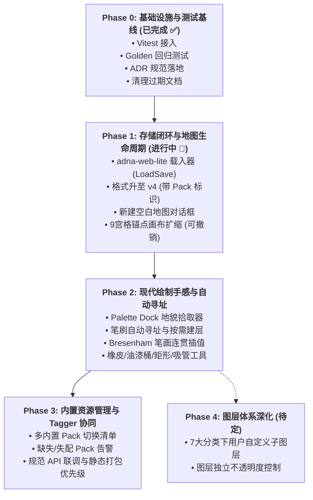

# Blueprint Studio 独立 TileMap 编辑器演进实施总方案 (Master Plan)

> **状态**：正式定稿（Approved & Master v2.1）  
> **更新日期**：2026-10-10  
> **定位简述**：将 Blueprint Studio 从“面向 AI 地图初稿的轻量审查/修补工具 (Reroll)”，演进为与 Desktop ImGui 平级的**独立轻量级 Web TileMap 编辑器**。保持既有数据模型与交互范式不变，系统性补齐建图生命周期、存储闭环与直觉绘图手感。

---

## 目录

- [一、 定位、核心决议与边界 (Decisions & Scope)](#一-定位核心决议与边界-decisions--scope)
- [二、 代码现状审计与事实校正 (Audited Current State)](#二-代码现状审计与事实校正-audited-current-state)
- [三、 核心突破口与非目标 (Breakthroughs & Non-Goals)](#三-核心突破口与非目标-breakthroughs--non-goals)
- [四、 分阶段实施路线图 (Phased Implementation Roadmap)](#四-分阶段实施路线图-phased-implementation-roadmap)
  - [Phase 0: 基础设施与测试基线 (已完成 ✅)](#phase-0-基础设施与测试基线-已完成-)
  - [Phase 1: 存储闭环与地图生命周期 (进行中 🚀)](#phase-1-存储闭环与地图生命周期-进行中-)
  - [Phase 2: 现代绘制体验与自动寻址](#phase-2-现代绘制体验与自动寻址)
  - [Phase 3: 内置资源管理与 Tagger 协同](#phase-3-内置资源管理与-tagger-协同)
  - [Phase 4: 图层体系深化 (待定)](#phase-4-图层体系深化-待定)
- [五、 关键数据契约与模块设计细节 (Technical Specifications)](#五-关键数据契约与模块设计细节-technical-specifications)
- [六、 风险对策与排期总览 (Risk Management)](#六-风险对策与排期总览-risk-management)

---

## 一、 定位、核心决议与边界 (Decisions & Scope)

经针对现有代码库的全面审计与用户决议，确立以下 6 条基石原则：

| 编号 | 决议事项 | 详细定义与后果 |
|:---|:---|:---|
| **D1** | **定位：Desktop ImGui 的平级轻量版** | 网页版不谋求取代 Desktop 引擎全保真编辑器，而是作为敏捷、跨平台的独立轻量编辑器。导出格式 `adna-web-lite` 必须始终保持为 Desktop TileMap 文档的有文档支持的**子集 profile**（`docs/WEB_LITE_REROLL_EDITOR.md` §4 继续有效）。 |
| **D2** | **数据模型：保持「对象 + role + palette」语义模型** | **坚决不引入 Tiled 式的全局 tile-index 网格**。地表保留为每个对象独立的 `TerrainMatrix`（§4.3），从而原生支持地表堆叠（如草地叠土路）以及与 Desktop 引擎的零损往返。 |
| **D3** | **交互范式：保留 Desktop 规范（RMB/LMB 职责分离）** | 严格维持 `docs/SELECTION_MODEL.md` 规则：**RMB = 拾取/移动，MMB = 视口平移，LMB = 当前激活工具（绘制/缩放/框选）**。不采用 Tiled 风格的单纯单键切换工具模式。 |
| **D4** | **资源管线：Tileset 网页内置只读** | 重申 §3.2 原则：**本编辑器不包含用户自带 PNG 切片导入与 Autotile 规则可视化编辑器**。Tileset 规则编辑未来将作为独立的专用编辑器构建。本编辑器与其解耦契约为 `.adnapalettepack` 与 `palette_tag_tree`。 |
| **D5** | **生态目标：专供 Adna 引擎** | 导出目标仅针对 Adna 引擎。**明确不做** Tiled (`.tmj`)、Godot 4、Unity 等第三方外部通用格式导出（避免有损烘焙与双向格式分叉）。 |
| **D6** | **生命周期：推翻 §3.6，支持自由新建与改尺寸** | 正式推翻旧方案 §3.6“永不新建地图、尺寸严格锁死”的限制，补齐“新建空白地图、自由调整画布尺寸、保存与重新打开”三项独立编辑器基础生命周期。 |

---

## 二、 代码现状审计与事实校正 (Audited Current State)

对照当前代码实测核对，纠正先前的误判，锁定真实技术盘点：

### 1. 事实澄清与校正
- **图层结构**：代码中实际由 `src/reroll/normalize.ts` 动态映射为 `src/reroll/roleTreeData.ts` 的 **7 个顶层 Role 分类**（`terrain`, `vegetation`, `structure`, `prop`, `boundary`, `water`, `road` 等），且带 `stratum`（ground/vertical）层叠。早先 `docs/LAYER_MODEL.md` 提及的 6 分类为已废弃未实施规范。
- **渲染管线**：目前已具备场景离屏 Canvas 缓存机制（`src/reroll/render.ts`），并支持脏矩形局部重绘（`sceneRectDirtyRef`、`renderSceneRegion`），缩放与平移非常轻量。
- **撤销重做**：笔刷动作目前已是一笔（MouseDown 到 MouseUp）封装为一个 Composite Undo 命令（`src/reroll/RerollEditor.tsx#L412-L420`）。
- **笔画插值缺失（确认属实）**：`src/reroll/components/CanvasView.tsx#L442` 目前仅在检测到当前 tile 变化时打下一个 dab，缺乏相邻点 Bresenham 插值，鼠标快速拖动会产生断续漏格。

### 2. 真实功能全貌盘点
- **对象编辑**：支持按 Role 创建（创建模态框：Role → Kind → Palette）、单选、Ctrl 多选、M 键框选（Marquee）、群组平移、Fixed Rect 边框形变、复制/粘贴（跨图层剪贴板）、删除、重命名、锁定（`web.lock`）、对象类型互转。
- **地表与形态学**：1/3/5 尺寸笔刷、地表矩阵自适应包围盒扩展、FastNoiseLite 过程式噪声预览/提交、形态学膨胀/腐蚀、位运算（AND/OR/SUBTRACT/COPY）、保持描边（Keep Border）、反转（Flip）。
- **参数化复合体**：九宫格房屋生成（墙体、屋顶自动拉伸与重叠行计算）、门窗烟囱等装饰插槽自由拖动；FRG 散布支持 5 种放置碰撞模式与 Cell 权重分配。
- **联调机制**：Tagger 标注可通过 `/api/reroll-pack` 实时向 Reroll 回写 Palette 角色映射。

---

## 三、 核心突破口与非目标 (Breakthroughs & Non-Goals)

### 1. 关键核心突破口
1. **闭环痛点：导出的存档无法重新打开**  
   目前系统只有 `liteToWebSave`（导出），没有配套的载入器（`webSaveToLite`）。用户一旦保存文件，无法在刷新后再次载入继续编辑，只能依赖以当前文件名绑定的 LocalStorage 草稿。**这是晋级独立编辑器的头号阻断点，必须在 Phase 1 优先解决并达成 100% Round-trip 验证。**
2. **绘制手感痛点：必须先选中对象才能动笔**  
   目前必须在左侧或画布选中特定地表对象，LMB 笔刷才能作画。独立编辑器的直觉体验应为：**用户在 Palette 面板点选所需地貌（如“草地”或“石径”），直接在画布涂抹，系统自动寻址或创建目标地表对象**。
3. **工程质量底线：零自动化测试**  
   仓库内此前没有任何测试用例，重构和功能叠加极易造成回归。必须先建立测试基线（Phase 0 已落地）。

### 2. 明确的非目标 (Explicit Non-Goals)
- ❌ **不做全局平铺 Tile-Index 瓦片层**（避免破坏堆叠与 Desktop 兼容性）。
- ❌ **不做用户本地 PNG 导入向导及 Autotile 规则编辑器**（留给未来的独立 Tileset 编辑器）。
- ❌ **不做 Tiled / Godot / Unity 导出器**。
- ❌ **不改动 RMB 拾取/移动、LMB 工具操作的基础分工**。
- ❌ **不做一次性的大范围目录重构**（不冒进拆分 core/ui，采取跟随功能小步抽离）。

---

## 四、 分阶段实施路线图 (Phased Implementation Roadmap)



---

### Phase 0: 基础设施与测试基线 (已完成 ✅)
*在任何重构之前，筑牢质量底线，澄清技术债务。*

- ✅ **任务 0.1：接入 Vitest 单元测试框架**
  - 在 `package.json` 安装配置 `vitest`，添加 `npm test` 脚本。
- ✅ **任务 0.2：建立核心链路 Golden 回归测试**
  - 构建端到端 Golden 快照测试：加载 `test_village_strict.blueprint.json` → `blueprintToLite` → `normalizeToCategories` → `liteToWebSave`，验证输出 JSON 与快照一致 (`src/reroll/__tests__/golden_convert.test.ts`)。
  - 为 `src/reroll/bitwise.ts`（地表矩阵形态学运算）、`src/reroll/pack/autotile.ts`（掩码查表算法）编写确定性单元测试。
- ✅ **任务 0.3：编写正式 ADR（架构决策记录）并修订文档**
  - 在 `docs/WEB_LITE_REROLL_EDITOR.md` 记录 D1~D6，明确注明 §3.6 被废弃、§3.2 被重申、§3.4 已演进。
  - 将过期的 `docs/LAYER_MODEL.md` 标注为 Superseded，正文引导至当前 7 大 Role 树实现。

**阶段验收结果**：
- `npm test` 9 个测试用例全部通过（~290ms）。
- `npm run build` 保持 0 错误编译通过（~689ms）。

---

### Phase 1: 存储闭环与地图生命周期 (进行中 🚀)
*彻底打破“只能进不能出”与“尺寸锁死”的限制，打通独立的创建与持久化回路。*

- **任务 1.1：开发 `adna-web-lite` 完整加载器 (`loadSave.ts`)**
  - 创建 `src/reroll/loadSave.ts`，实现 `webSaveToLite(save: WebSaveFile): LiteTileMap`。
  - 核心解析逻辑：
    - 校验文件 Magic `format === "adna-web-lite"`，支持版本兼容。
    - 依据导出的 `cells` 和 `rect` 恢复 `TerrainMatrix`（0 为填充，-1 为空白）。
    - 完整反序列化 `frg`（放置模式、噪声、权重）、`house`（墙体高度、重叠层、门窗插槽）、`dungeon` 轮廓点、以及全部 tags。
    - 基于图层 tag `role.stratum` 还原 `vertical` 属性；基于 `adna.kind` 恢复 `isBlueprint` 标识；分配会话稳定全局递增 ID。
  - 在文件载入分流中集成：打开 `.json` 时，嗅探若包含 `format: "adna-web-lite"` 则走此加载器，否则继续走 Blueprint 转换。
- **任务 1.2：存档升级为 Schema v4**
  - 在存档根对象新增 `pack: { id: string; name: string }` 元数据，记录当前生效的 PalettePack。
  - 解除 `tileResolution` 写死为 16 的限制，动态跟随地图设定。
  - 打开存档时若发现 Pack 标识不符，弹出非阻塞告警提示，防止材质悄然失效。
  - 同步更新 `docs/WEB_LITE_SCHEMA.md`。
- **任务 1.3：新建空白地图对话框 (New Map Modal)**
  - UI 包含：地图名称、宽度 (Tiles)、高度 (Tiles)、瓦片分辨率（16/32/自定义）。
  - 创建后自动初始化 7 个标准的空 Role 分类图层，配置默认背景地表或留空，初始化空 UndoStack。
- **任务 1.4：画布尺寸动态调整 (Canvas Resize with Anchor)**
  - 模态框支持输入新宽高，提供 9 宫格锚点选择（左上、居中、右下等）。
  - 安全平移与裁切算法：
    - 按锚点偏移平移各对象 `rect`、`terrain.ox/oy`、`borderPoints`。
    - 地表矩阵执行边界交集裁切，完全脱离画布范围的对象自动标记移除。
    - 整个改动打包为一个原子操作 `resizeMapCommand`，完全可 Undo/Redo。
- **任务 1.5：菜单栏升级与会话升级**
  - 顶栏重构为标准菜单：**新建 (New)**、**打开 (Open)**、**保存/导出 (Save/Export)**。
  - LocalStorage 草稿 Key 改为地图内部唯一会话 ID，避免不同地图文件名冲突覆盖。

**阶段验收标准**：
- **Round-Trip 保证**：任意编辑后地图导出为 `.json`，重新载入后，对象数量、坐标、地形矩阵、tags 与再次导出数据完全一致。
- 新建地图 → 绘制要素 → 保存为文件 → 刷新浏览器 → 重新打开文件，完整无损复原。
- 执行画布调整与撤销操作，地图尺寸及要素坐标精确复原。

---

### Phase 2: 现代绘制体验与自动寻址
*实现专业绘画软件级的直觉操作体验，让用户专注绘制本身。*

- **任务 2.1：Palette Dock 交互面板**
  - 在界面（底部或左侧）新增直观的 Palette 调色板坞，分类列出当前 Pack 中所有可用的地貌（Grass, Sand, Dirt, Water, Road 等）。
  - 点击即可将该地貌设为当前 LMB 笔刷激活材质。
- **任务 2.2：笔刷“自动寻址与按需建层”（实现 §4.3 核心设计）**
  - 彻底改变“必须先手动选定对象才能画”的流程。LMB 落笔时，系统自动寻址目标对象：
    1. 若当前选中的对象正是匹配该 Role / Palette 的地表对象，直接落笔；
    2. 否则，在对应 Role 所属图层中查找 Palette 绑定相同的最顶层对象作为目标；
    3. 若该图层尚无对应对象，自动新建该地表对象并将其加入图层（新建动作与首次笔画合并为单个 Undo 命令）。
- **任务 2.3：Bresenham 连续笔画插值算法**
  - 改造 `src/reroll/components/CanvasView.tsx` 中的 PointerMove 采样逻辑，引入 Bresenham 直线连续插值。
  - 无论用户鼠标滑动多快，落笔轨迹保持 100% 连续饱满，消除断点。
- **任务 2.4：绘图工具箱扩充（挂载于 LMB）**
  - **自由画笔 (Pencil / B)**：支持方形/圆形笔刷，尺寸 1~9 像素动态切换。
  - **橡皮擦 (Eraser / E)**：切换当前笔刷为擦除模式（清空矩阵 cell）。
  - **油漆桶 (Flood Fill / G)**：基于 4 邻域连通域的泛洪填充，支持将相连的空白或同质区域一次性注满。
  - **几何矩形工具 (Shape Rect / U)**：按住拖拽绘制实心或中空矩形地块。
  - **材质吸管 (Eyedropper / Alt+Click)**：点击画布提取当前格最上层物体的 Role/Palette 并设为当前笔刷。
  - 与现有的框选（Marquee M）、参数化创建工具融合入统一的 Active Tool 状态机。
- **任务 2.5：Tool 控制器小步解耦**
  - 将庞大的 CanvasView 指针分流逻辑适度解耦，在 `src/reroll/tools/` 抽象出 `PencilTool`、`FillTool`、`RectTool` 纯函数控制器。

**阶段验收标准**：
- 用户新建空白地图后，无需在图层树点选任何对象，在调色板点击“草地”即可一笔画出大片草地；点击“石路”可直接在草地上叠画出连续道路，Autotile 边缘融合表现正确。
- 快速甩动画笔，线条平滑连续无缺失空洞。
- 油漆桶填充能在 100×100 地图上毫秒级完成连通域填充。
- 每一个绘制步骤均为单次原子 Undo 命令。

---

### Phase 3: 内置资源管理与 Tagger 协同
*理顺内置图集资产与标注闭环。*

- **任务 3.1：多内置 PalettePack 管理支持**
  - 在 `public/sample/` 或 `public/packs/` 引入包清单，允许在设置中切换不同的官方内置图集包。
  - 地图文件内嵌当前 Pack 的 ID 引用，打开时自动校验与加载对应包。
- **任务 3.2：资源与开发环境优先级固化**
  - 明确 `/api/reroll-pack`（本地开发联动更新）与静态预打包文件的 fallback 机制，完善容错日志。
- **任务 3.3：Asset Tagger 职责边界稳固**
  - Tagger 继续作为专注打标审核的专业工具，生成 `.adnapalettepack` 供编辑器消费。保持两者的松耦合契约。

**阶段验收标准**：
- 切换不同风格内置包时，地图自动重新编译 Palette 绑定并刷新渲染。
- 打开缺少对应 Pack 的存档时，给出明确警告而非崩溃或静默失效。

---

### Phase 4: 图层体系深化 (待定)
*视实际使用诉求在 P2 之后评估决策。*

- **候选方向**：在现有的 7 大 Role 顶层图层下方，允许用户自由新建、重命名、拖拽子图层（如 `terrain/base_grass` 与 `terrain/upper_dirt`），并支持调节图层全局不透明度。
- **前置原则**：导出保存时，子图层须保持扁平化展开为符合 Desktop 规范的合法 Layer，确保 100% 遵守 D1 子集约束。

---

## 五、 关键数据契约与模块设计细节 (Technical Specifications)

### 1. `adna-web-lite` v4 数据格式规范

```jsonc
{
  "format": "adna-web-lite",
  "version": 4,                        // 升级为 v4
  "name": "coastal_outpost",
  "width": 80,
  "height": 60,
  "tileResolution": 16,               // 动态记录
  "pack": {                           // v4 新增：资源包追踪契约
    "id": "palettes_v1",
    "name": "Standard Retro Pack"
  },
  "layers": [
    {
      "name": "terrain",
      "enabled": true,
      "tags": {
        "adna.kind": "blueprint",
        "role.root": "terrain",
        "role.stratum": "ground"
      },
      "objects": [
        {
          "type": "TERRAIN_2_CORNER",
          "rect": [10, 10, 30, 20],
          "enabled": true,
          "tags": {
            "blueprint.role": "terrain/grass",
            "web.palette": "a1b2c3d4..."
          },
          "cells": [[10, 10], [11, 10], /* 绝对坐标列表 */]
        }
      ]
    }
  ]
}
```

### 2. 工具控制器状态流 (Tool Controller Interface)

```typescript
export interface ToolContext {
  map: LiteTileMap;
  view: View;
  activeRole: string;
  activePalette: string | null;
  brushSize: number;
}

export interface ToolResult {
  dirtyRect?: Rect;
  command?: Command;
}

export interface CanvasTool {
  id: "pencil" | "eraser" | "bucket" | "shape_rect" | "eyedropper" | "marquee";
  onPointerDown(e: PointerEvent, tileX: number, tileY: number, ctx: ToolContext): ToolResult;
  onPointerMove(e: PointerEvent, tileX: number, tileY: number, ctx: ToolContext): ToolResult;
  onPointerUp(e: PointerEvent, ctx: ToolContext): ToolResult;
}
```

---

## 六、 风险对策与排期总览 (Risk Management)

| 潜在风险 | 影响度 | 防范与应对对策 |
|:---|:---:|:---|
| **笔刷自动定位命中非预期对象** | 中 | 1. 严格按“当前选中 > 相同 Palette 的最顶层对象 > 新建”优先级寻址；<br>2. 画布状态栏实时显示当前笔刷即将写入的目标对象名称；<br>3. 允许按住 `Shift` 强制新建独立对象。 |
| **重构导致既有手势与交互断裂** | 高 | 必须先完成 Phase 0 的 Golden 回归测试套件，在保护网建立后再进行 Phase 1 和 Phase 2 的具体开发（Phase 0 已通过）。 |
| **存档格式向前/向后兼容性** | 中 | 格式变更严格遵循 SemVer 原则，加载器必须对旧版 v1/v2/v3 保持向上兼容自动升版。 |
